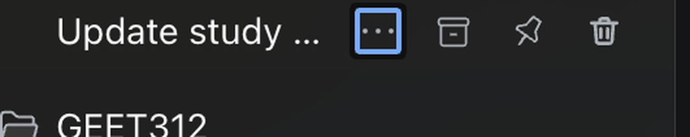
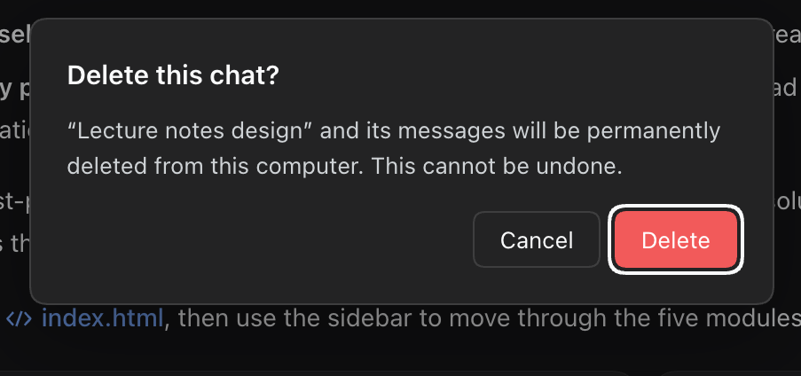

# dsh-chat-delete

Delete individual chats from the DeepSeek Harness sidebar. The shipped browser groups Sessions under Workspaces and can delete a Workspace, but it has no way to remove one chat: chats can only be archived. This plugin adds a trash button to every chat row and a **Delete chat** item to its `…` menu, with a confirmation dialog.





## Install

From a DeepSeek Harness profile, either form works — the published spec, or a local checkout:

```text
plugin_manager install_bundle  target=github:Berikai/dsh-chat-delete
plugin_manager install_bundle  target=/absolute/path/to/dsh-chat-delete
```

The bundle inserts one Host row named `dsh-chat-delete` and declares its browser half through `dsh.client`. If the sidebar button does not appear after installation, reload the window once (`⌘R` / `Ctrl+R`).

## Use

Hover a chat row and press the trash button, or open the row's `…` menu and choose **Delete chat**. Confirm in the dialog. The chat and its messages are removed from this computer and the row disappears immediately. Workspace deletion is unchanged and still keeps its sessions.

The blank **New Session** draft has no stored log, so it shows no delete button.

### Safety checks

Two kinds of chat refuse deletion, with the reason shown inside the dialog:

| Chat state | Result |
| --- | --- |
| Open in the main view or a tab | Refused — close that view first. |
| Running, or holding active work (turn, subagent, background job, scheduled reminder) | Refused — stop the work first. |

An idle chat that is merely loaded in the Host's memory is safe to delete: its files are complete on disk, and the page drops it from its catalog through the existing `api-session/removed` event.

## How it works

- **Host** (`index.js`) registers one authenticated `POST /chat-delete/delete` route on `ctx.webServer`. The route asks `ctx.connection.requestRejection()` first, exactly like the shipped `open-in-app` endpoints, so the Harness Host/Origin fence and login cookie gate every call. It accepts a small `application/json` body (`{ "sessionId": "…" }`), refuses running/active Sessions through `ctx.agents` and the `workspace/session-activity` waterfall, resolves the Session's log path through `sessionPersistence`, verifies that path stays inside the configured Session root, removes the Session's own directory, drops its pin/archive membership, and emits `api-session/removed`.
- **Browser** (`client.js`) contributes to three existing seats: `sidebar.workspaces.session.row.action` (the trash button), `contextMenu.icon` (its glyph), and `shell.overlay` (the frame-wide confirmation dialog). The `…` menu action comes from `ctx.contextMenus`. All visible copy is localized through the plugin's `chat-delete` locale namespace (English and Chinese).

No data leaves the machine.

## Limitations

- The chat currently open in a view cannot be deleted until you close it.
- Removal is permanent: there is no trash or undo.
- The Session log directory is removed, but content-addressed attachments that only that chat referenced are not garbage-collected, and cached projection rows for the removed id may linger harmlessly.
- Only one chat is deleted at a time; there is no bulk action.
- Built and verified against DeepSeek Harness `0.2.2-rc.1`. It relies on public Client slots and Host services, but a future Harness release may change them.

## Development

No build step; the package ships plain ES modules.

```sh
node --test        # Host route: validation, auth fence, refusals, real deletion
node --check index.js
node --check client.js
```

The tests run the registered route handler against a temporary Session root and a fake Host context, including a real directory deletion and a path-escape refusal.

## License

[MIT](LICENSE)
